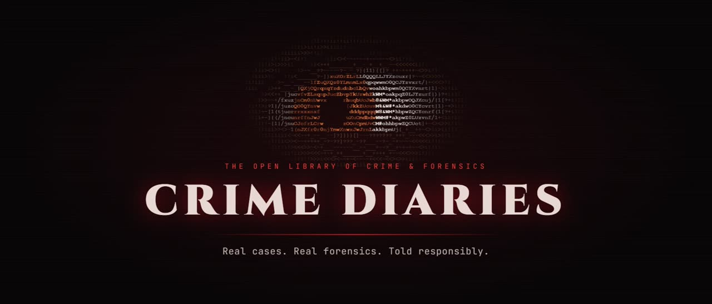
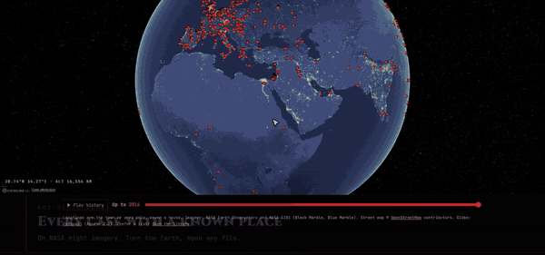
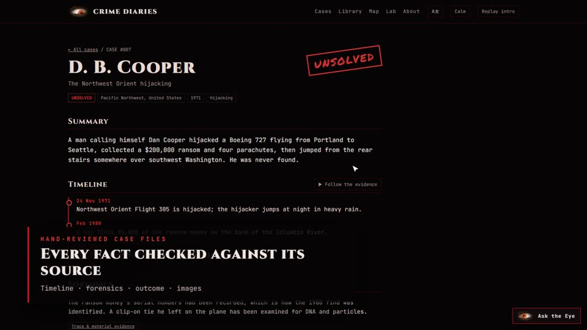
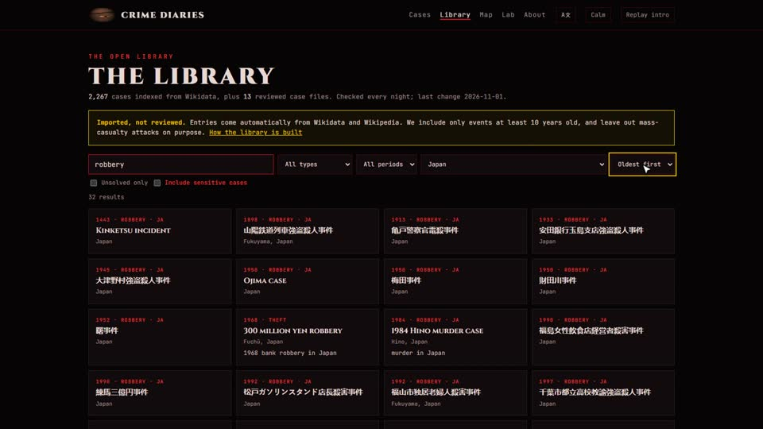
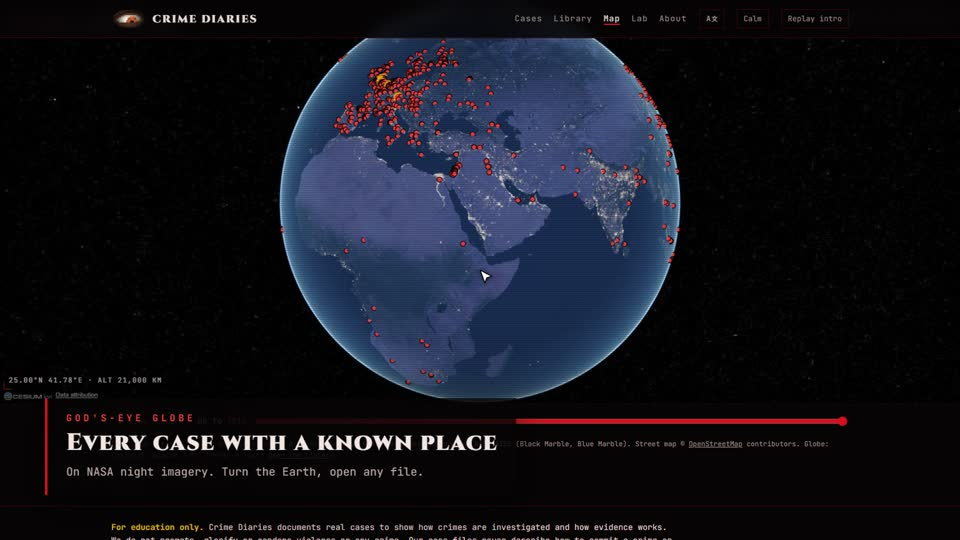
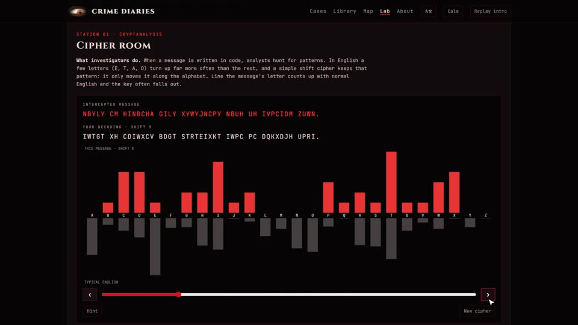
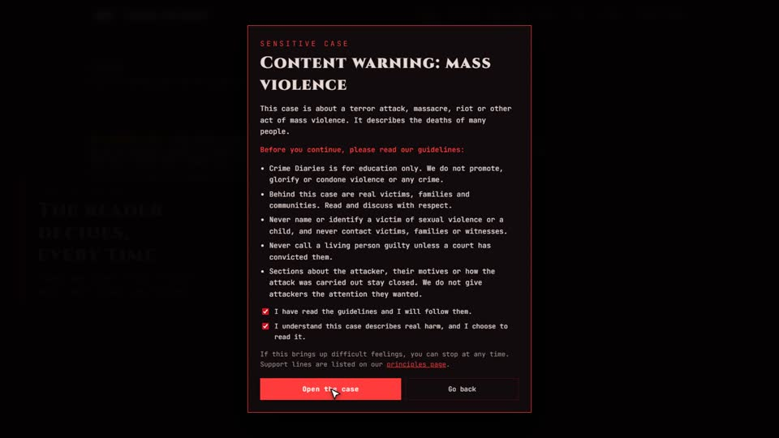

<p align="center"></p>

<p align="center">
  <b>An open, community library of real crime cases and the forensic science that solved them.</b><br>
  For education only. Built with respect for victims.
</p>

<p align="center">
  
  
  
  
</p>

<p align="center"><b><a href="https://crime-diaries.github.io/crime-diaries/">Open the live site →</a></b></p>

<p align="center">
  <a href="#run-it">Run it</a> ·
  <a href="#whats-where">What's where</a> ·
  <a href="about.html">Principles</a> ·
  <a href="privacy.html">Privacy</a> ·
  <a href="terms.html">Terms</a> ·
  <a href="credits.html">Credits</a>
</p>

---

<p align="center"></p>

## What's inside

| | |
|---|---|
|  | **Hand-reviewed case files.** Timeline, forensics, outcome and free-licensed images, every fact checked against its source. |
|  | **The open library.** Thousands of cases indexed from Wikidata and Wikipedia in 71 languages, with full reports read on the site and a built-in translation guide. |
|  | **God's-eye globe.** Every case with a known town on NASA imagery: fly, filter, switch to night vision, open any file. |
|  | **Forensics lab.** Try the methods investigators use: codebreaking, fingerprint comparison, DNA profiling. |
|  | **Responsible by design.** Sensitive cases open behind a content warning; attackers get no spotlight; victims of sexual violence are never named; recent cases are held back. |

## How it runs

```
Open data  ──►  Nightly build  ──►  Static site
Wikidata · Wikipedia      GitHub Actions          no database,
Commons · NASA            (no server)             no servers
```

Plain HTML, CSS and JavaScript. No build step for the site and no server: the library is rebuilt from open data by a GitHub Action, and live numbers are fetched by the browser from public APIs. Accounts (optional) use Supabase; see [`supabase/SETUP.md`](supabase/SETUP.md).

## Run it

```bash
cd crime-diaries
python3 -m http.server 8000   # Windows: py -m http.server 8000
```

Open http://localhost:8000. A first visit shows the education-only notice; the intro plays only if the visitor chooses it there, or later with **Replay intro**. **Calm** (top right) turns animation off; it is on by default for people whose system asks for reduced motion.

Use the server rather than double-clicking `index.html`: browsers won't let a page opened from a file read video frames, so the intro would fall back to its drawn figures instead of the filmed clips.

## What's where

| Path | What it is |
|---|---|
| `index.html` | Home: intro, eye hero, reviewed cases, library teaser, forensics, live numbers, community |
| `case.html` | A reviewed case file (`case.html?id=<case-id>`) with Follow the evidence and discussion, or a library entry (`case.html?wd=<Wikidata id>`) with a live Wikipedia summary and no discussion |
| `library.html` | Search and filter the whole library |
| `map.html` | 3D globe (CesiumJS, NASA imagery, no API key) of every case with a known town: history slider, Night/Day/Streets views, night-vision and noir looks, homicide rate by country (World Bank, live). Falls back to the flat Leaflet map without WebGL |
| `data/world.js` | Country outlines for the homicide layer, built once by `scripts/build-world.mjs` |
| `js/globe.js` | The globe. `map.html?debug` exposes the viewer as `window.__globe` for testing |
| `lab.html` | Forensics Lab: cipher, fingerprint and DNA mini-games with invented data |
| `about.html` | Our principles: disclaimer, what we never publish, sources and licences, help lines |
| `account.html` | Sign in, create an account (18+, accept terms), download or delete your data |
| `saved.html`, `js/favorites.js` | Saved cases: ☆ Save on any case card or case page, kept in this browser only (no account needed) |
| `privacy.html`, `terms.html`, `credits.html` | Privacy policy, terms of use, credits and licences |
| `data/cases.js` | The reviewed case files and forensic methods |
| `data/library.js` | Generated library index. Do not edit by hand |
| `scripts/build-library.mjs` | Builds `data/library.js` from Wikidata (`node scripts/build-library.mjs`, Node 18+) |
| `.github/workflows/library.yml` | Runs the build every night at 03:17 UTC and commits changes |
| `js/chrome.js` | Shared on every page: notice, Calm mode, nav eye, Replay, helpers (`window.CD`) |
| `js/report.js` | Full report on library pages: the Wikipedia article section by section, fact box, collapsed violent passages, safe image gallery |
| `js/config.js` | Site settings: Supabase URL and anon key (empty = accounts off), document versions, contact email |
| `js/auth.js` | Account link and legal links on every page; sends a signed-in user who has not accepted the current terms to the account page |
| `js/account.js` | The account page |
| `supabase/` | `schema.sql` (database rules) and `SETUP.md` (how to turn accounts on) |
| `css/fonts.css`, `fonts/`, `vendor/` | Self-hosted fonts and the Supabase library, with their licences |
| `js/sensitive.js` | Content warning for sensitive cases, and the protected page for sexual-violence and child cases |
| `data/sensitive.js` | Generated sensitive cases. Do not edit by hand |
| `js/translate.js` | The A文 nav button: animated guide to the browser's own translator, and in-page translation (Chrome 138+) on reports |
| `scripts/crawl-categories.mjs` | Finds cases through Wikipedia's per-country crime categories (deep for countries with few cases) |
| `js/library.js`, `js/map.js`, `js/lab.js`, `js/live.js` | Library, flat-map fallback, lab and live-numbers logic |
| `js/intro.js` | The cinematic intro (eye, thought bubbles, four scenes, title) |
| `js/eye.js` | The ASCII eye that follows the pointer (hero and nav bar) |
| `js/site.js` | Home and case page logic |
| `js/ask.js` | "Ask the Eye" panel (keyword search over the case files for now) |
| `js/posts.js` | Comments/theories storage. Browser-only for now; replace this one file to connect a database |
| `js/discussion.js` | Comments and Theories tabs on the case page |
| `media/` | Intro clips `scene1–4.mp4` and `gunshot.mp3` |
| `docs/research.md` | Product research: landscape, gaps, legal red lines |
| `prototypes/opener.html` | The original standalone intro animation |

## Data without a server

- **Library:** `scripts/build-library.mjs` asks Wikidata for crime events with a Wikipedia article in any language and writes `data/library.js` (English title when Wikidata has one; `l` holds the article language otherwise). GitHub Actions runs it nightly, so the site stays current while GitHub Pages serves plain files. Run it by hand any time.
- **Rules in the build:** only events at least 10 years old; undated items dropped; mass murder, mass and school shootings, terrorist, suicide and bomb attacks excluded (copycat risk); no offender names or images; coordinates at town level.
- **Category crawl:** the build also walks Wikipedia's crime categories for every country (about 25 to 50 minutes, one polite request at a time). Locally, `CRAWL_CACHE=1 node scripts/build-library.mjs` reuses the last crawl from `cache/` and takes about a minute; `DROP_LOG=1` writes `cache/drops.json` with why each case was left out.
- **Sensitive cases** (terror attacks, massacres, riots, mass killings, lynchings, sexual violence, and child cases in India) go to `data/sensitive.js`, loaded only when a visitor turns on "Include sensitive cases". Each opens behind a content warning (`js/sensitive.js`). Attack reports keep sections about the attacker closed ("No Notoriety"). Sexual-violence and child cases are **protected**: the build keeps only a neutral title, year, country and a location rounded to whole degrees, and the page shows convicted adults and outcome sentences with other names removed. Never add a victim's name, the article title or a place to these entries.
- **Still left out:** cases that ended less than 10 years ago (proceedings may be active), and anything in `REMOVED`.
- **Live in the browser:** library summaries come from the Wikipedia REST API (CC BY-SA, credited on the page); home-page numbers come from data.police.uk (England, Wales, Northern Ireland).
- **Live site:** GitHub Pages serves `main` from the repo root at https://crime-diaries.github.io/crime-diaries/ and redeploys on every push, including the nightly library commit. `.nojekyll` tells Pages to serve the files as they are. Keep every link relative (no leading `/`), because the site lives under `/crime-diaries/`.

## Intro clips

The four scenes play `media/scene*.mp4` converted to ASCII; any missing clip falls back to drawn figures. Order, start point and speed of each clip are set in `CLIPS` in `js/intro.js`. The gunpoint clip plays last and its shot leads into the title.

## Working together

```bash
git pull            # get your partner's latest changes before you start
# ...make changes...
git add -A
git commit -m "Describe what you changed"
git push
```

If `git push` is rejected, someone pushed first: run `git pull`, fix any conflicts, then push again.

## Content rules

This site is about real people. Before adding or editing a case:

- Facts only in case articles, each with a source. Theories go in the Theories tab.
- Never name a living person as guilty unless a court has convicted them.
- No graphic images, and never show how someone died.
- Never describe how to commit a crime. Write about the investigation, the evidence and the victims, not the method, and give offenders as little attention as possible.
- See `docs/research.md` for the legal red lines (defamation, privacy, active trials, GDPR, copyright).
